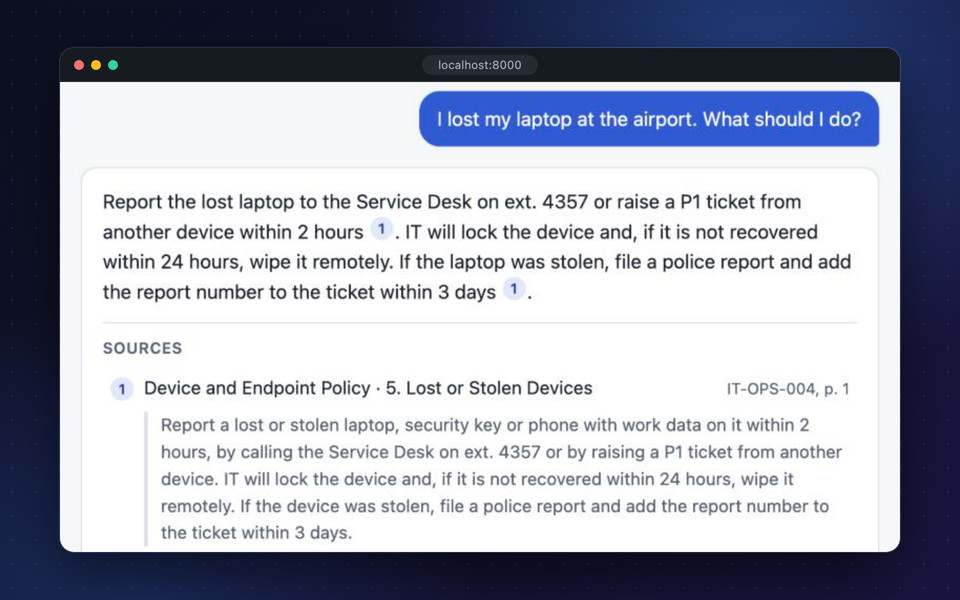
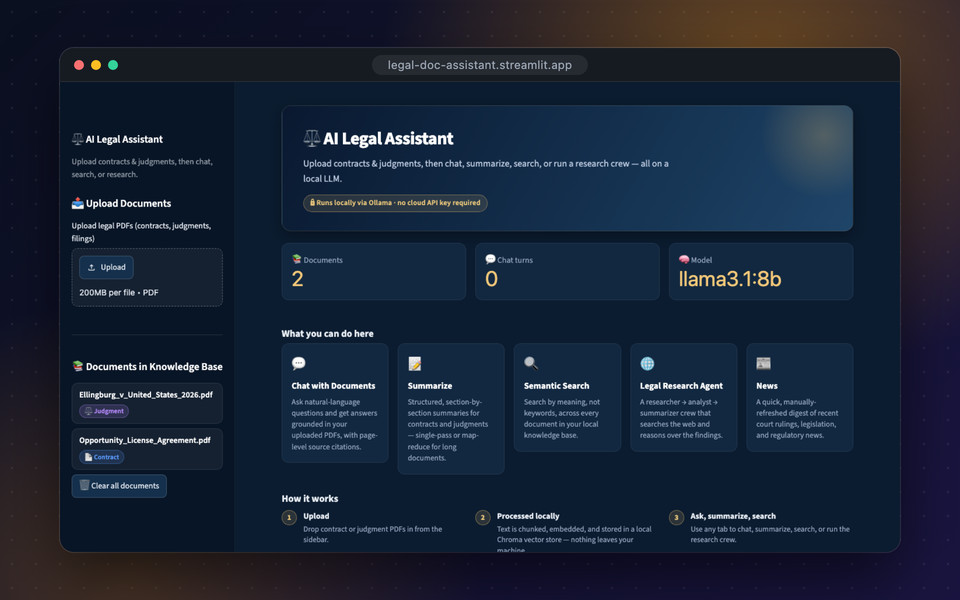
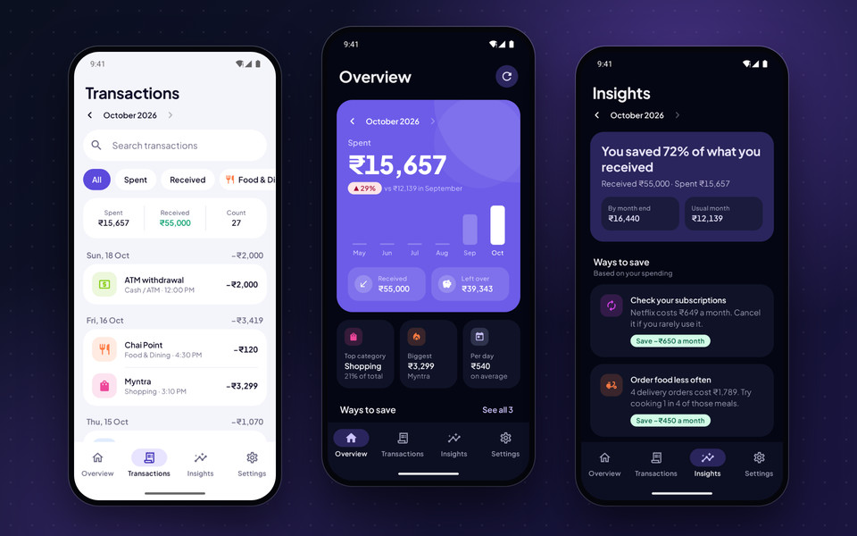
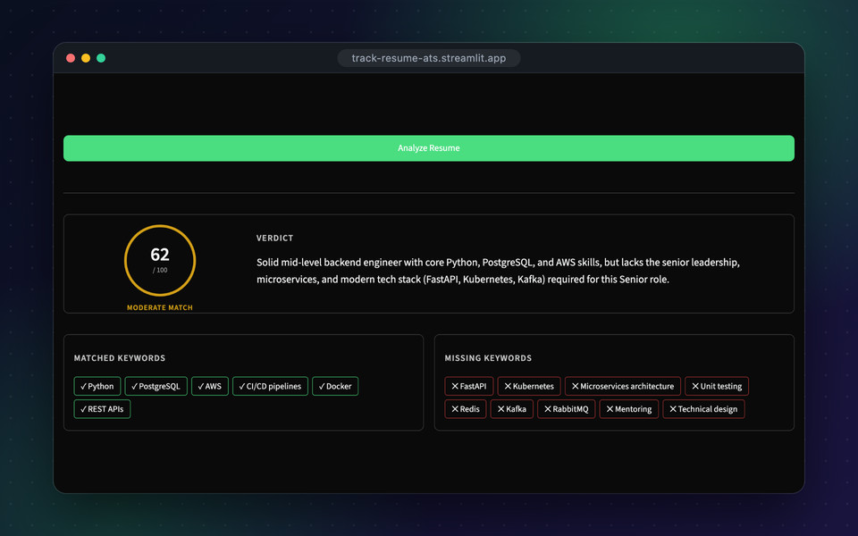
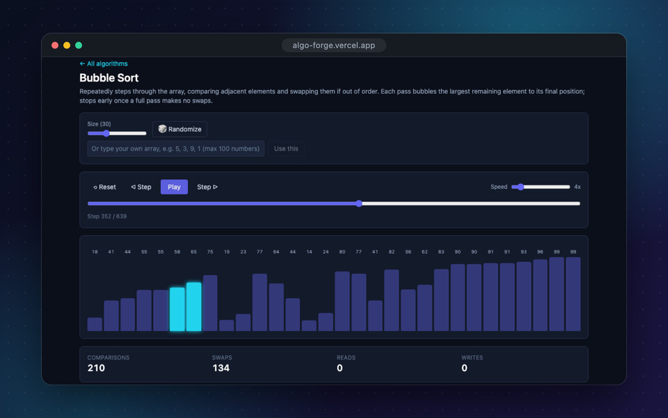
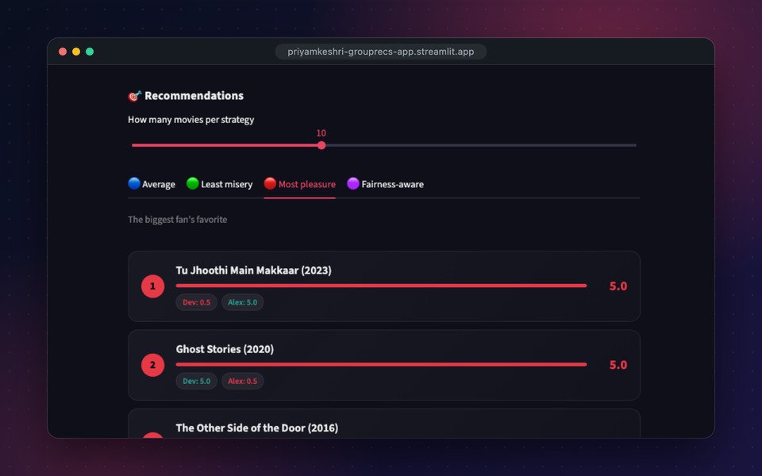

<picture>
  <source media="(max-width: 640px)" srcset="https://raw.githubusercontent.com/PriyamKeshri/PriyamKeshri/HEAD/assets/header-mobile.svg">
  
</picture>

  
  
  

I'm a **Computer Science graduate** with a strong interest in **Artificial Intelligence, Machine Learning, Generative AI, and Software Engineering**. I enjoy turning ideas into practical applications — from machine learning pipelines and RAG systems to AI-powered applications, APIs, web applications, and developer tools.

Currently, I'm focused on building **portfolio-grade AI/ML projects** and deepening my understanding of modern AI engineering.

## 🚀 Featured Projects

<table>
  <tr>
    <td width="50%" valign="top">
      
      <h3><a href="https://github.com/PriyamKeshri/Support-Assistant">Agentic Support Assistant</a></h3>
      
Answers IT questions from company policy PDFs, cites its sources, and says so when it doesn't know. Hybrid search and reranking put the right policy section first for 89% of questions.

      

        
        
        
        
      

      
🔗 <a href="https://github.com/PriyamKeshri/Support-Assistant#results">Eval Results</a> · <a href="https://github.com/PriyamKeshri/Support-Assistant">Source Code</a>

    </td>
    <td width="50%" valign="top">
      
      <h3><a href="https://github.com/PriyamKeshri/Ai-Legal-Assistant">AI Legal Assistant</a></h3>
      
Local-first RAG for contracts and judgments: cited chat, summaries, semantic search and a CrewAI research crew. Runs on a local Ollama model, so documents never leave your machine.

      

        
        
        
        
        
      

      
🔗 <a href="https://legal-doc-assistant.streamlit.app">Live Demo</a> · <a href="https://github.com/PriyamKeshri/Ai-Legal-Assistant">Source Code</a>

    </td>
  </tr>
  <tr>
    <td width="50%" valign="top">
      
      <h3><a href="https://github.com/PriyamKeshri/Spendwise">Spendwise</a></h3>
      
Private Android expense tracker that does the bookkeeping from your bank's SMS alerts and Paytm statements, then turns your history into saving tips. No account, no cloud, no internet permission.

      

        
        
        
      

      
🔗 <a href="https://github.com/PriyamKeshri/Spendwise/releases/latest">Download APK</a> · <a href="https://github.com/PriyamKeshri/Spendwise">Source Code</a>

    </td>
    <td width="50%" valign="top">
      
      <h3><a href="https://github.com/PriyamKeshri/Resume-ATS-Tracking">Resume ATS Tracker</a></h3>
      
Scores a resume against a job description with Google Gemini, surfaces keyword gaps, rewrites weak bullet points and drafts a tailored cover letter, with Markdown/PDF export.

      

        
        
        
      

      
🔗 <a href="https://track-resume-ats.streamlit.app">Live Demo</a> · <a href="https://github.com/PriyamKeshri/Resume-ATS-Tracking">Source Code</a>

    </td>
  </tr>
  <tr>
    <td width="50%" valign="top">
      
      <h3><a href="https://github.com/PriyamKeshri/Algo-forge">AlgoForge</a></h3>
      
Interactive algorithm laboratory for visualizing, debugging and comparing algorithms and data structures: step-by-step execution, time-travel debugging, benchmarking and an AI-powered tutor.

      

        
        
        
        
      

      
🔗 <a href="https://algo-forge.vercel.app">Live Demo</a> · <a href="https://github.com/PriyamKeshri/Algo-forge">Source Code</a>

    </td>
    <td width="50%" valign="top">
      
      <h3><a href="https://github.com/PriyamKeshri/GroupRecs">GroupRecs</a></h3>
      
Fair group movie recommendation system: matrix factorization built from scratch, cold-start profiling for new users, and social-choice strategies that balance individual preferences with group fairness.

      

        
        
        
      

      
🔗 <a href="https://priyamkeshri-grouprecs-app.streamlit.app">Live Demo</a> · <a href="https://github.com/PriyamKeshri/GroupRecs">Source Code</a>

    </td>
  </tr>
</table>

## 🧠 Tech Stack

<table>
  <tr>
    <td><b>Languages</b></td>
    <td>
      
      
      
      
      
      
    </td>
  </tr>
  <tr>
    <td><b>Machine Learning</b></td>
    <td>
      
      
      
      
      
    </td>
  </tr>
  <tr>
    <td><b>Generative AI</b></td>
    <td>
      
      
      
      
      
    </td>
  </tr>
  <tr>
    <td><b>Data &amp; Retrieval</b></td>
    <td>
      
      
      
      
      
      
    </td>
  </tr>
  <tr>
    <td><b>Web &amp; Backend</b></td>
    <td>
      
      
      
      
      
      
      
      
    </td>
  </tr>
  <tr>
    <td><b>Mobile</b></td>
    <td>
      
      
    </td>
  </tr>
  <tr>
    <td><b>Cloud &amp; Tools</b></td>
    <td>
      
      
      
      
      
      
      
      
    </td>
  </tr>
</table>

## 🧑‍💻 About Me

🎓 **B.Tech in Computer Science & Engineering**, Graphic Era Hill University, Dehradun 
🤖 Currently focused on **AI/ML & Generative AI**: RAG, LLM applications, AI agents and agentic workflows 
📚 Learning deeper **Machine Learning, Neural Networks, Deep Learning & TensorFlow** 
🛠️ Building practical projects rather than only following tutorials 
📈 Interested in **algorithmic trading and quantitative systems** 
🌐 Strong interest in backend, APIs and full-stack application development 
🎯 Goal: build production-quality AI systems and grow into an **AI/ML Engineer**

## 🔥 Contribution Streak

  

## 💭 Current Goal

> **Build intelligent systems that are not just impressive demos, but useful, maintainable and production-ready applications.**

---

**Thanks for stopping by — always happy to connect and talk about AI/ML, GenAI, or interesting engineering problems.**

⭐ *If any of these projects are useful to you, a star is always appreciated!*

